# Architecture

[← Back to docs](README.md) · [Decision log](decisions.md) · [Roadmap](../openspec/ROADMAP.md)

Rust port of the OpenSimulator 0.9.3.0 server (grid services and region
simulator). Wire and schema compatibility with the C# server is the contract;
internals are free to change. Licence: LGPL-3.0-or-later. The C# reference tree
(`opensim-0.9.3.0-source`) is read-only and kept alongside this repository.

Status: pre-alpha. 22 changes completed and archived (476 tasks); 6 active
changes in progress (167/281 tasks done). See
[remaining parity](remaining-parity-summary.md) for the full breakdown.

## Workspace

Cargo workspace (`Cargo.toml`, edition 2024, `members = ["crates/*"]`). All
crates are prefixed `opensim-`.

<details>
<summary>Full crate table (26 crates — click to expand)</summary>

| Crate | Role | State |
|---|---|---|
| `welkin-types` | SL protocol enums and bitfields: asset, inventory, folder and wearable types, attachment points, `PermissionMask` | implemented |
| `welkin-llsd` | Wrapper over `aurora-llsd`, plus server-side XML-RPC codec (`src/xmlrpc.rs`) for login and legacy calls | implemented |
| `welkin-msg` | Wrapper over `aurora-msg` (framing, zero-coding, typed messages). `src/objects.rs` adds server-direction object update encoders | implemented |
| `welkin-prim` | Re-exports from `aurora-prim`, plus physics meshing: analytic box/sphere, volume and sculpt trimeshes, LOD selection, mesh asset decoder (`mesh_asset.rs`), V-HACD convex decomposition, shape and decomposition caches, linkset compound colliders (`meshing.rs`). See `docs/prim-meshing-summary.md` | implemented |
| `welkin-net` | Server-side LLUDP: `circuit.rs`, `throttle.rs`, plus `server.rs` (listener), `client.rs` (per-viewer state), `dispatch.rs` (message-id table), `handlers.rs` (viewer handlers) | implemented |
| `welkin-config` | TOML configuration with env overrides; `OpenSim.ini` / `Robust.ini` importer | implemented |
| `welkin-runtime` | Logging (`tracing`), Prometheus metrics, health endpoint, graceful shutdown | implemented |
| `welkin-conformance` | Recorder/replayer (HTTP, XML-RPC, LLUDP), `pCampBot` wrapper, test bot (`tests/test_bot.rs`) | implemented |
| `welkin-physics` | `PhysicsScene`/`PhysicsActor` traits, null backend, and solver-independent behaviour: vehicles (`vehicle.rs`), avatar controller (`avatar.rs`), move-to-target/hover/look-at (`behaviors.rs`), keyframed motion (`keyframe.rs`), terse-update thresholds (`terse_update.rs`) | implemented |
| `welkin-physics-rapier` | Rapier 0.36.1 backend: prims and linksets, terrain heightfield, collisions, probes, materials, snapshot/restore; consumes `aurora-prim` geometry | implemented |
| `welkin-caps` | HTTP capabilities: per-session seed cap, LLSD event queue long-poll, fetch, region info and upload cap handlers | implemented (thin handlers) |
| `welkin-capacity` | Host scan (CPU, memory with cgroup limits, disk, container), network stub, `HostReport`, 12 sourced coefficients, estimate engine with quiet/typical/busy profiles. `benchmark`, `model` and `live` modules are stubs pending the region simulator | partial |
| `welkin-data` | `sqlx` data layer: 13 stores over MariaDB, PostgreSQL and SQLite, plus a migration runner with 53 embedded C# schema files | implemented |
| `welkin-services` | 14 Robust grid service handlers behind axum: asset, inventory, grid, presence, griduser, accounts, auth, authorization, friends, avatar, mute, profiles, map, estate, agent preferences, simulation (501 stub) and XML-RPC login | implemented |
| `welkin-scene` | Scene, object groups and parts, presences, XML2 serializer, terrain (channel, file I/O, brushes, compression), region manager, shutdown | implemented |
| `welkin-modules` | Region modules (land, permissions, chat, groups, profiles, NPCs, IM, IRC, concierge) | implemented |
| `welkin-archive` | OAR/IAR archives: OAR single/multi-region save/load, IAR save/load, OspResolver, ExternalRepresentationUtils, console commands (9,555 lines, 205 tests) | implemented |
| `welkin-script-vm` | Luau VM via mlua: `ScriptInstance`, `ScriptScheduler`, `RegionTransferBundle`, `ScriptState` save/restore, 206 `ll*` builtins, 236 `os*` with threat levels, events and detected parameters. See `docs/script-engine-summary.md` and `docs/ossl.md` | implemented |
| `welkin-script-compiler`, `-api` | LSL-to-Luau transpiler; scene-bound script API | implemented |
| `welkin-realmwalker` | Rust-native bot/client SDK: async login, UDP circuit, chat, movement, objects. BSD 3-Clause (ported from LibreMetaverse). See `docs/realmwalker.md` | implemented (84 tests) |
| `welkin-migration` | C# OpenSim to Welkin migration tool: config converter, DB validator, password upgrade (Argon2id) | implemented |
| `welkin-portal` | Grid portal: staff auth (argon2), sessions, RBAC roles, audit log, region control, pages, grid map, people/sign-up, first-run wizard, content/catalogue | implemented |
| `welkin-companion` | Tauri 2 desktop app: tray icon, service start/stop, log viewer, notifications, remote grid connect. **Standalone**: excluded from workspace (`Cargo.toml` exclude) | implemented |
| `welkin-robust` | Binary: grid services | skeleton (`main.rs`) |
| `welkin-region` | Binary: region simulator (config, multi-region, LLUDP and caps startup, graceful shutdown) | implemented |


</details>

## Dependency graph (current)

```mermaid
graph TD
    subgraph Aurora["Aurora Viewer crates (pinned)"]
        A_LLSD[aurora-llsd]
        A_MSG[aurora-msg]
        A_PRIM[aurora-prim]
        A_NET[aurora-net]
    end

    subgraph Core["Core crates"]
        TYPES[welkin-types]
        LLSD[welkin-llsd]
        MSG[welkin-msg]
        NET[welkin-net]
        CONFIG[welkin-config]
        RUNTIME[welkin-runtime]
    end

    subgraph Services["Services layer"]
        DATA[welkin-data]
        CAPS[welkin-caps]
        SERVICES[welkin-services]
        PORTAL[welkin-portal]
        CAPACITY[welkin-capacity]
    end

    subgraph Simulation["Simulation layer"]
        SCENE[welkin-scene]
        MODULES[welkin-modules]
        PHYSICS[welkin-physics]
        RAPIER[welkin-physics-rapier]
        PRIM[welkin-prim]
        ARCHIVE[welkin-archive]
    end

    subgraph Scripts["Script engine"]
        VM[welkin-script-vm]
        COMPILER[welkin-script-compiler]
        API[welkin-script-api]
    end

    subgraph Clients["Client SDKs"]
        REALMWALKER[welkin-realmwalker]
    end

    subgraph Binaries["Binaries"]
        ROBUST[welkin-robust]
        REGION[welkin-region]
        COMPANION[welkin-companion]
        CONFORM[welkin-conformance]
        MIGRATION[welkin-migration]
    end

    A_LLSD --> LLSD
    A_MSG --> MSG
    A_PRIM --> PRIM
    A_PRIM --> RAPIER
    A_NET -.->|test bot only| CONFORM

    LLSD --> NET
    MSG --> NET
    PHYSICS --> RAPIER

    TYPES --> LLSD & MSG & NET & CAPS & DATA & SCENE & PHYSICS & ARCHIVE & VM

    CONFIG --> ROBUST
    RUNTIME --> ROBUST
    DATA --> SERVICES
    CAPS --> SERVICES
    SERVICES --> ROBUST
    SCENE --> MODULES
    SERVICES --> MODULES
    CAPACITY --> PORTAL
    PORTAL --> ROBUST

    COMPILER --> VM
    VM --> API

    COMPANION -.->|HTTP| PORTAL

    MSG --> REALMWALKER
    TYPES --> REALMWALKER
    MIGRATION --> DATA
```



<details>
<summary>Text version (for terminals)</summary>

```text
aurora-llsd -> welkin-llsd -------------------+
aurora-msg  -> welkin-msg --------------------+--> welkin-net
aurora-prim -> welkin-prim, welkin-physics-rapier
welkin-physics -> welkin-physics-rapier (rapier3d 0.36.1)
welkin-types <- llsd, msg, net, caps, data, scene, physics, archive, scripts

welkin-config, welkin-runtime -> welkin-robust
welkin-data, welkin-caps -> welkin-services -> welkin-robust
welkin-scene, welkin-services -> welkin-modules
welkin-capacity -> welkin-portal -> welkin-robust (portal router)
welkin-companion (standalone, Tauri 2) --HTTP--> welkin-portal control interface
welkin-script-compiler -> welkin-script-vm -> welkin-script-api
welkin-msg, welkin-types -> welkin-realmwalker (bot/client SDK)
welkin-data -> welkin-migration (C# to Welkin migration tool)
aurora-net (test bot only) -> welkin-conformance, dev-dep of welkin-msg
```

</details>

Layering rule: nothing outside a wrapper crate imports an `aurora-*` crate
directly (the one exception is `welkin-types`, which re-exports shared
definitions, and `welkin-conformance`, which needs `aurora-net` as a client).

## Aurora crates reused

Aurora Viewer (LGPL-3.0-or-later) is the acceptance viewer. Its crates are
unpublished (`publish = false`, 0.1.0) and change daily, so they are git
dependencies pinned to commit `3d523b14a17bbc6484b208378c0eef291ad5ac32`
(workspace `Cargo.toml`) and wrapped. Updating the pin is a reviewed change
gated by the replay tests.

| Crate | Used for | Why reused |
|---|---|---|
| `aurora-llsd` | LLSD in XML, binary, notation | Standalone, complete; replaces part of libopenmetaverse |
| `aurora-msg` | Packet framing, zero-coding, message types generated from the Linden message template, reader and writer | Avoids regenerating the codec; same template the viewer uses |
| `aurora-prim` | Prim params, texture entries, extra params, sculpts, geometry generator | Needed for physics shapes and object updates; large to rewrite |
| `aurora-assets` | JPEG 2000, mesh, mesh physics hulls (pulls `openjpeg-sys`, C code) | Declared in the workspace; evaluation pending (audit task 2.5) |
| `aurora-net` | Viewer-side client protocol | Test bot only; never linked into the server |

Aurora is a viewer, so some paths exist in one direction only. Gaps found in
the inventory (protocol-core 1.2) are filled in `welkin-msg` (object update
encoders) and offered upstream.

## Other key dependencies

`tokio` and `axum` (async runtime and HTTP), `sqlx` (MariaDB, PostgreSQL,
SQLite over the existing schema), `rapier3d` 0.36.1 (physics backend, behind
the `welkin-physics` trait), `glam` (vectors, as in Aurora), `tracing`,
`metrics` with `metrics-exporter-prometheus`, `serde`/`toml`.

## Build and deployment

- `Containerfile` (multi-stage, Podman and Docker, static binaries, non-root,
  one image per binary). `compose.yaml` starts database, `robust` and one
  region; `compose.reference.yaml` runs unmodified C# OpenSim as the
  conformance reference.
- A region advertises its external host and UDP port to viewers, so the
  published port must equal the advertised one.
- `scripts/check.sh`: fmt, clippy (`-D warnings`), tests, `cargo deny check`.
  `deny.toml` holds the licence allow-list.

## Verification

1. Unit tests ported with the code.
2. Recorded C# request/reply pairs replayed (`welkin-conformance`,
   `test-data/lludp_session.jsonl`).
3. Test bot on `aurora-net` logs in against a simulator.
4. Fuzz targets in `crates/welkin-msg/fuzz/`.
5. Grid services: 14 replay tests and 4 multi-step wire-traffic tests (`welkin-conformance/tests`).
6. Later: live `pCampBot`, physics trajectory comparison against recorded C# runs, Aurora Viewer sessions.

Physics details: `docs/physics-backend-summary.md`. Grid services details: `docs/grid-services-summary.md`. Region simulator details: `docs/region-simulator-core-summary.md`. Capacity assessor details: `docs/capacity-assessor-summary.md`. Grid portal details: `docs/grid-portal-summary.md`.

## Region simulator

Details in `docs/region-simulator-core-summary.md`.

- `welkin-region` loads config, opens databases, builds one `Scene` per
  region (`RegionManager` for several), starts the LLUDP listener and the caps
  HTTP server, and registers with the grid.
- `welkin-net` receives UDP, routes to a per-viewer `LLUDPClient`, and
  dispatches by message id to typed handlers that mutate the `Scene`.
- `welkin-caps` serves per-session capabilities and the LLSD event queue.
- `welkin-scene` holds groups, parts, presences and the terrain channel;
  `xml2.rs` is the C#-compatible object format.
- `welkin-data::simulation` persists objects (XML2), terrain, settings and
  spawn points over the C# `regionstore` tables. The scene loop saves dirty
  objects on a timer and on shutdown.
- Open before production: bounded client map, bounded channels, stale session
  reaping (second review, 3 HIGH).

## Grid Portal

The portal is served by the `robust` binary via `axum`, with GridGate's page set
as the model. It is the single management interface for the grid.

### welkin-portal crate (2,084 lines, 12 source files)

| Module | Responsibility |
|---|---|
| `auth.rs` | Argon2id password hashing (OWASP defaults via `argon2` 0.5), login/logout handlers, TOTP stub (locked: returns false until implemented) |
| `sessions.rs` | In-memory session store (HashMap), `RequireStaff` axum extractor, Bearer token and cookie extraction, expiry enforcement |
| `roles.rs` | `StaffRole` enum: Admin, Operator, Viewer with `can_manage_accounts()` and `can_manage_regions()` checks |
| `audit.rs` | In-memory audit log (to be persisted to SQLite) |
| `region_control.rs` | CRUD + start/stop/snapshot for regions (process management stubs pending region-simulator-core) |
| `pages.rs` | Portal HTML shell, status, logs, metrics, audit endpoints |
| `map.rs` | Region placement with coordinate conflict detection, spiral free-coordinate finder, variable sizes, external grid overlay (6 tests) |
| `people.rs` | Sign-up with approval, account search/suspend, password reset with token store; all staff handlers enforce `require_admin()` |
| `wizard.rs` | 7-step first-run wizard: mode → owner → network → capacity → placement → content → finish |
| `content.rs` | Catalogue format with licence fields, OAR import, terrain presets, backup scheduling |

### Security model

- **Authentication:** Argon2id with OsRng salt, UUID v4 session tokens, constant-time password verification.
- **Authorization:** RBAC: Admin (full access), Operator (region management), Viewer (read-only). People/account management requires Admin. Region management requires Operator or above.
- **Security review findings:** 3 HIGHs fixed (TOTP stub locked, role enforcement on people endpoints, password hashed at sign-up). 5 MEDIUMs noted for deployment hardening (rate limiting, cookie CSRF flags, bot protection, audit persistence, body size limit). Full report: `scratchpad/security_review_portal.md`.

### welkin-companion crate (standalone Tauri 2 app)

Not part of the workspace; has its own `Cargo.toml` with Tauri 2 dependencies.
Excluded via `exclude = ["crates/welkin-companion"]` in workspace `Cargo.toml`.

- WebView pointing at the local portal (`http://localhost:8002/`)
- System tray: status indicator, start/stop service, open portal, show window, quit
- Tauri commands: `start_service`, `stop_service`, `service_status` (systemctl), `view_logs` (journalctl), `open_portal`, `connect_remote`, `list_remote_grids`, `set_portal_url`
- Desktop notifications for service start/stop
- `.desktop` launcher file for Linux, bundle config for Windows/macOS in `tauri.conf.json`

### install/ directory

| File | Purpose |
|---|---|
| `install.sh` | Full install: distro detection, prereqs, system user, directories, config generation, admin token, DB setup, systemd service, start |
| `upgrade.sh` | Backup config, stop service, replace binary, run migrations, restart |
| `uninstall.sh` | Stop, disable, remove binary/service; preserves data |
| `install-archive.sh` | Release tarball install to `/opt/opensim/` (non-container path) |
| `welkin-robust.service` | Systemd unit file |
| `container/Containerfile` | Multi-stage Rust build → Debian slim runtime |
| `container/compose.yaml` | Compose with optional MySQL/PostgreSQL |

### E2E test

`crates/welkin-portal/tests/e2e_portal_flow.rs`: 14-stage integration test
via `tower::ServiceExt::oneshot()` covering: portal page, status, wizard (7
steps), login, region lifecycle, map placement, people sign-up/approval,
authenticated pages, content, access control, logout.

## Phase 2 summary

Phase 2 complete: 53 tasks across 3 changes. All accepted.

| Change | Tasks | Lines | Key deliverables |
|---|---|---|---|
| `grid-services` | 14/14 | ~2,800 | 14 HTTP service handlers (asset, inventory, grid, presence, auth, login, etc.), replay conformance tests (14 fixtures), interop wire-traffic tests (4 multi-step flows), Opus security review with 1 fix (constant-time hash comparison) |
| `capacity-assessor` | 13/13 | ~600 | Host scanning (CPU, memory with cgroup limits, disk, container), 12 sourced coefficients, estimate engine with 3 workload profiles, stubs for benchmark/model/live pending region-simulator-core (Phase 3) |
| `grid-portal` | 26/26 | ~3,800 | 2,084-line portal crate, installer scripts, Tauri 2 companion app, 14-stage e2e test, Opus security review with 3 fixes |

Phase 2 total: 111/142 overall tasks complete at the time of Phase 2 sign-off.
All subsequent phases through remaining-parity have since been completed and
archived (476 tasks total). See [remaining parity](remaining-parity-summary.md)
for current numbers.

## External grid mode

Grid profiles let a region join a grid it does not run. See
`docs/external-grid-mode-summary.md`.

| Component | Location | Role |
|---|---|---|
| Grid profiles | `welkin-config/src/profile.rs` | `Standalone`, `OwnGrid`, `Custom(name)`; TOML loader, override chain, importer for C# `GridCommon.ini` (generates the `osgrid` profile) |
| Remote connectors | `welkin-services/src/remote/` | Asset, grid and inventory clients (inventory read-only) |
| Asset cache | `welkin-services/src/cache.rs` | Local cache with expiry |
| Registration | `welkin-services/src/registration.rs` | Register, deregister, neighbour notification |
| Hypergrid traits | `welkin-services/src/hypergrid.rs` | Gatekeeper, UserAgent, asset, inventory, friends, IM traits with stubs |
| Wizard checks | `welkin-services/src/wizard.rs` | Region name, coordinates, estate owner, ports |

The remote grid is treated as hostile. Review `docs/security-review-remote-writes.md`
found 1 CRITICAL (SSRF) and 4 HIGH issues that block use against an untrusted grid.

## Script engine

Scripts run on Luau through mlua 0.12, one VM per script. See
`docs/script-engine-summary.md`.

| Component | Location | Role |
|---|---|---|
| Instance | `welkin-script-vm/src/instance.rs` | One VM, memory limit, event queue, dispatch |
| Scheduler | `scheduler.rs` | Round-robin by instruction limit, timers, event broadcast |
| Transfer | `transfer.rs` | `RegionTransferBundle` for region crossing |
| State | `lib.rs` | `ScriptState` (bytecode and globals JSON), `new_vm_with_memory_limit` |
| `ll*` | `builtins/` | 206 functions over a shared `ScriptContext` |
| `os*` | `ossl/` | 236 functions gated by `OsslThreatLevel` and `OsslConfig`; see [OSSL reference](ossl.md) |
| Events | `events.rs` | `DetectedInfo`, `EventContext`, `llDetected*`, `dispatch_event` |

Sandboxing review found 2 HIGH issues (unfrozen globals, unbounded event queue)
that block production use. See `docs/security-review-script-sandboxing.md`.

## OSSL API

The `os*` layer lives in `welkin-script-vm/src/ossl/` (13 files). See
`docs/ossl-api-summary.md`.

| Component | Role |
|---|---|
| `OsslThreatLevel` | 8 levels, mirrors C# `ThreatLevel` |
| `OsslConfig` | Threat ceiling plus `function_perms` (`Disabled`, `Everyone`, `AllowList` of roles and UUIDs) |
| INI loader | `[OSSL]` section, `Allow_<Function>`, `osslParcelO`/`osslParcelOG`/`osslNPC` macros |
| `register_ossl()` | Registers only permitted functions into the Luau globals |
| `function_catalog()` | Name and threat level for every function |

About 90 functions have real implementations (draw, string, math, crypto, time,
sim/grid info, terrain, NPC, health, speed, sun/wind); the rest are stubs
awaiting their subsystem. Review found 1 HIGH (PBKDF2 hash, since corrected)
and 2 MEDIUM (role checks deferred, `expect()` in crypto); see
`docs/security-review-ossl-api.md` and `docs/ossl.md` for the full reference.

## Region modules

`welkin-modules` holds the region modules (land, permissions, estate,
inventory, attachments, chat, IM, world map, environment, avatar, entity
transfer, framework). See `docs/region-modules-summary.md`.

| Component | Role |
|---|---|
| `RegionModule` | Lifecycle trait: `initialise`, `add_region`, `remove_region`, `close`; `ModuleType` is `Shared` or `NonShared` |
| `ModuleRegistry` | Owns modules; `TypeId`-keyed interface lookup via `register_interface` and `get_module` |
| `SceneEvents` | Typed `tokio::sync::broadcast` event bus; modules communicate through events |
| `DefaultPermissionsModule` | 13 check functions; reviewed, CONDITIONAL PASS |
| `EntityTransferStateMachine` | 6 states, validated transitions, blocks double teleport |
| `MapImageModule` | tiny-skia 256x256 JPEG tiles |

278 tests. Review found 1 CRITICAL (nil UUID owner match) and 3 HIGH (god
gating, bypass default); see `docs/security-review-permissions.md`.

## Archives

`welkin-archive` handles OAR (region) and IAR (inventory) archives. See
`docs/archives-summary.md`.

| Component | Role |
|---|---|
| `RegionSettingsSerializer` | XML read/write for region settings |
| `LandDataSerializer` | XML read/write for parcel data |
| OAR write/read | Single and multi-region, merge, displace, rotate, bbox, permission filter |
| IAR write/read | Inventory tree walk, folder creation, item insertion |
| `OspResolver` | `first.last` name-to-UUID mapping for cross-grid portability |
| `ExternalRepresentationUtils` | Creator/owner UUID rewriting on dearchive |
| `ArchiverModule` | `save oar` / `load oar` console commands |
| `InventoryArchiverModule` | `save iar` / `load iar` console commands |

Uses `tar` + `flate2` instead of the C# custom tar implementation. 205 tests
(174 unit, 31 integration). Review found 0 critical, 0 high, 5 medium
(defense-in-depth gaps); see `docs/security-review-archives.md`.

## Social modules

Groups V2, OfflineIM, user profiles, NPCs, Concierge and IRC bridge. See
`docs/social-modules-summary.md`.

| Component | Role |
|---|---|
| `GroupsService` | Backend with sqlx, CRUD, HTTP handlers matching C# Robust |
| `GroupsModule` | Region-side: group packets, caps, membership |
| `GroupsMessagingModule` | Group IM routing, notices with attachments, session chat |
| `HGGroupsServiceConnector` | Hypergrid group federation, ForeignImporter |
| `OfflineIMService` + module | Store/retrieve offline IMs, deliver on login |
| `UserProfilesService` + module | Profile text, partner, picks, classifieds, notes |
| `NPCAvatar` + `NPCModule` | Fake IClientAPI, create/move/say/sit/stand/remove |
| `ConciergeModule` | Lobby announcements, HTTP broker notifications |
| `IRCBridgeModule` | IRC-to-in-world chat bridge via `irc` crate (MPL-2.0) |

~12,500 lines, 444 tests (391 unit, 36 integration, 17 protocol replay).
Review found 0 critical, 3 high (IRC injection, group creation power check,
notice attachment size), 10 medium; see `docs/security-review-social-modules.md`.

## Hypergrid

Cross-grid federation: Gatekeeper, UserAgent, suitcase inventory, HG assets,
friends, IM, HypergridLinker, and 10 region modules. See
`docs/hypergrid-summary.md`.

| Component | Role |
|---|---|
| `GatekeeperService` | Foreign visitor entry, hyperlink creation, access control |
| `UserAgentService` | Outbound HG teleport, session verification, UUI format |
| `HGSuitcaseInventoryService` | Restricted suitcase folder for foreign visitors |
| `HGAssetService` | Access-controlled asset transfer, export type filtering |
| `HGFriendsService` + module | Cross-grid friendship, secret verification, online/offline |
| `HGInstantMessageService` | Cross-grid IM routing via UserAgent location resolution |
| `HypergridLinker` | Grid-to-grid region linking, `link-region`/`unlink-region` commands |
| Service connectors | HTTP clients for Gatekeeper, UserAgent, HGFriends, HELO probe |
| `HGEntityTransferModule` | Cross-grid teleport, appearance restriction, inventory transfer |
| `HGInventoryAccessModule` + Broker | Route inventory to local/remote, suitcase enforcement |
| `HGLureModule`, `HGWorldMapModule`, `HGUserManagementModule` | Lures, map blocks, foreign user resolution |
| `HypergridServiceInConnectorModule` | Expose HG endpoints in simulator |

~9,144 lines, 265 tests (215 unit, 50 integration). CRITICAL RISK review
found 3 critical (suitcase escape, VerifyAgent missing, UUID impersonation),
3 high, 3 medium, 2 low; see `docs/security-review-hypergrid.md`.

## WebRTC voice

WebRTC voice via wolfvoice sidecar. See `docs/webrtc-voice-summary.md`.

| Component | Role |
|---|---|
| `WebRtcVoiceModule` | Shared region module, IVoiceModule trait, channel lifecycle |
| `WolfvoiceClient` | JSON-RPC client: provision, channel create/destroy, health |
| `ProvisionVoiceAccountRequest` | Map agent UUID to voice credentials via wolfvoice |
| `ParcelVoiceInfoRequest` | Estate/parcel voice check, channel URI construction |
| OSSL integration | Wire `osSetParcelSIPAddress` to voice module |
| Docker/portal integration | Sidecar service definition, admin dashboard status |

~2,079 lines, 102 tests (59 unit, 43 integration). Neither Vivox nor
FreeSWITCH are ported; Aurora Viewer supports WebRTC voice only.
Review found 0 critical, 2 high (wolfvoice auth, rate limiting), 3 medium;
see `docs/security-review-voice.md`.

## Roadmap

See `openspec/ROADMAP.md` for phases 1 to 7, and `docs/decisions.md` for the
decision log.
